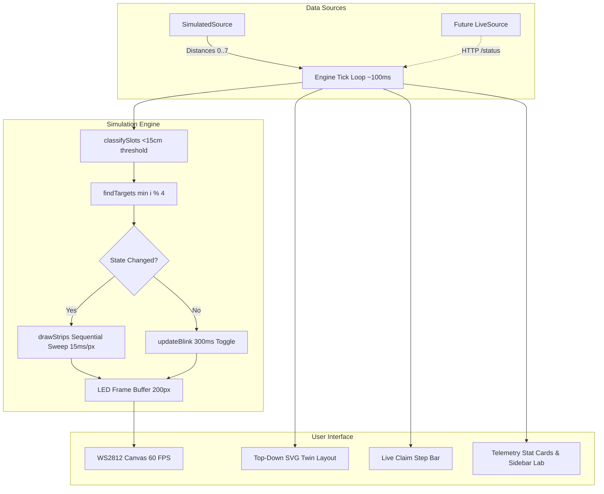

<p align="center">
  
</p>

# ParkWay — Digital Twin

[](https://www.typescriptlang.org/)
[](https://react.dev/)
[](https://vitejs.dev/)
[](https://tailwindcss.com/)
[](https://vitest.dev/)
[](https://playwright.dev/)
[](#architecture)

**ParkWay** - a digital twin of an ultrasonic parking guidance system that lights the way to the nearest vacant slot. High-fidelity in-browser simulation of an **ESP32-based IoT parking guidance system** using 8 ultrasonic distance sensors (HC-SR04) and two addressable WS2812 LED strips (100 pixels each). The application runs 100% locally in the browser with **zero backend dependencies**, faithfully replicating physical microcontroller behavior, sequential LED sweeps, and patent claims.

> [!IMPORTANT]
> **SIMULATED TELEMETRY DISCLAIMER**: All sensor measurements, telemetry streams, and hardware responses in this application are generated by an in-browser physics model and simulation engine. They represent a high-fidelity digital twin of the physical ESP32 firmware (`reference/smart_parking.ino`).

---

## Table of Contents
1. [Key Features](#key-features)
2. [Architecture & System Flow](#architecture--system-flow)
3. [Firmware Source-of-Truth Mapping](#firmware-source-of-truth-mapping)
4. [Running Scenarios](#running-scenarios)
5. [Patent Claim Verification Engine](#patent-claim-verification-engine)
6. [Simulated vs. Live Architecture (Future LiveSource)](#simulated-vs-live-architecture-future-livesource)
7. [Edge States & Fault Injection](#edge-states--fault-injection)
8. [Performance & Accessibility](#performance--accessibility)
9. [Development & Testing](#development--testing)
10. [Production Deployment (Vercel / Netlify)](#production-deployment-vercel--netlify)

---

## Key Features

- **Full Digital Twin Layout**: Top-down SVG parking facility with upper row (Slots S1–S4 / Lane 0) and lower row (Slots S5–S8 / Lane 1), animated vehicle routes, entrance gate kiosk, and red preservation logic.
- **Hardware-Accurate WS2812 LED Twin**: High-performance dual 100-pixel HTML5 Canvas strip running at 60 FPS via `requestAnimationFrame` with real blocking sweep options (15 ms/pixel) and 300 ms target beacon blinking.
- **Sensor Lab (Sidebar)**: Collapsible sidebar controller with compact ultrasonic distance inputs (2–400 cm) for slots S1–S8 organized across Lane 0 and Lane 1, keyboard arrow adjustments, and instant digital twin synchronization.
- **Guidance & Hardware Architecture**: Interactive SVG redraw of patent Figure 3 with clickable reference numerals (101–108), live component telemetry inspector, and WS2812 strip GPIO hardware badges.

---

## Architecture & System Flow



### Component Structure
- **Engine Core (`src/engine/`)**: Pure TypeScript simulation loop replicating the exact loop sequence from `reference/smart_parking.ino` (classify $\rightarrow$ target selection $\rightarrow$ state comparison $\rightarrow$ sequential sweep $\rightarrow$ blinking).
- **Zustand Store (`src/store/`)**: State store maintaining live simulation state, sensor models, and event streams.
- **Scenarios Engine (`src/scenarios/`)**: Timeline executor supporting keyframed scenarios, captioned commentary, patent claim traces, and scrub playback.

---

## Firmware Source-of-Truth Mapping

All digital twin algorithms faithfully match the physical C++ microcontroller firmware in `reference/smart_parking.ino`:

| Firmware Concept (`smart_parking.ino`) | Physical Value / Logic | Digital Twin Equivalent (`src/engine/`) |
| :--- | :--- | :--- |
| **Topology** | 8 slots (4 slots per lane across 2 lanes) | `NUM_SLOTS = 8`, `LANES = 2`, `SLOTS_PER_STRIP = 4` |
| **WS2812 Strips** | 2 × 100 pixels (25 px/slot) | `PIXELS_PER_STRIP = 100`, `PIXELS_PER_SLOT = 25` |
| **GPIO Pin Data** | Strip 1: `GPIO 23`, Strip 2: `GPIO 15` | Documented in `GuidanceHardwarePage.tsx` and pin telemetry |
| **Ultrasonic Pins** | `trigPins[8] = {5, 18, 19, 21, 13, 14, 26, 33}`<br>`echoPins[8] = {4, 17, 16, 22, 12, 27, 25, 32}` | Verified via `SENSOR_PINS` in `src/engine/types.ts` |
| **Occupancy Rule** | `slotOccupied[i] = (slotDistance[i] < 15)` | `classifySlots()` in `engine.ts` with 15 cm threshold |
| **Target Selection** | `best = min(i % 4)` across all vacant slots | `findTargets()` in `engine.ts` (Global min relative position) |
| **Sweep Routine** | `((targetSlot % 4) + 1) * 25 - 1` @ 15 ms/pixel | `generateSweepSteps()` in `engine.ts` |
| **Red Preservation** | `if (slotOccupied[slot]) continue;` | Red pixels preserved; never overwritten by green sweep |
| **Loop Blocking** | Microcontroller blocks for `endPixel * 15ms` | `blockedUntilMs` tracks controller blind window |
| **Target Blinking** | Toggles target between Bright Green and Off every 300 ms | `updateBlink()` toggles `blinkOn` state every 300 ms |
| **Telemetry Endpoint** | HTTP `GET /status` returning JSON | `toStatusJson()` in `statusShape.ts` (Firmware JSON contract) |

### Known Difference: Firmware Mode vs. Patent Enhanced Mode
- **Firmware Mode (Default)**: Uses the firmware's global minimum position `(i % 4)` across all 8 slots. If S1 (Lane 0) and S5 (Lane 1) are both vacant, both blink concurrently as a cross-lane tie.
- **Patent Enhanced Mode**: Implements independent per-lane destination selection as originally conceived in the patent description, where Lane 0 and Lane 1 independently target their own nearest bay.

---

## Running Patent Claim Scenarios

The digital twin includes 5 patent claim verification scenarios directly playable from the Patent Claim Tracer on the Overview page:

- **Live Claim Step Bar**: Positioned directly above the digital twin layout, this sticky card displays the live scenario status, current step text, active subsystem indicator (with animated ESP32 chip highlight), and Stop, Replay, and Reset controls. When no claim is running, it remains in place with an idle hint.
- **Patent Claim Tracer**: Interactive selector below the twin allowing one-click execution of patent claims 1, 5, 7, 11, and 12 with real-time hardware twin animation.

---

## Patent Claim Verification Engine

Interactive selector directly on the Overview page verifying the following patent claims:

- **Claim 1 (Core Architecture)**: Verifies ultrasonic sensing $\rightarrow$ ESP32 microcontroller $\rightarrow$ red status indicators $\rightarrow$ sequential green LED guidance $\rightarrow$ web dashboard telemetry.
- **Claim 5 (Nearest Available Slot Selection)**: Evaluates entrance-proximity relative position minimization (`min(i % 4)`).
- **Claim 7 (Dynamic Rerouting)**: Proves instant target invalidation and sequential sweep redirection when a target bay is preempted.
- **Claim 11 (Continuous Monitoring Loop)**: Demonstrates ~100 ms continuous polling loop running concurrently during ongoing LED sweeps.
- **Claim 12 (In-Situ Physical Visual Guidance)**: Contrasts direct pavement/curb visual guidance with driver distraction from smartphone navigation apps.

---

## Simulated vs. Live Architecture (Future LiveSource)

The codebase is built with a pluggable source abstraction to enable future integration with physical ESP32 hardware:

```typescript
export interface SensorSource {
  getDistances(): number[];
  setDistance?(slotIndex: number, cm: number): void;
  setAllDistances?(distances: number[]): void;
}
```

### Transitioning to a Physical Hardware Feed
To connect the dashboard to a real physical ESP32 on the local Wi-Fi network:

1. **Implement `LiveSource`**:
   ```typescript
   export class LiveSource implements SensorSource {
     private distances: number[] = new Array(8).fill(400);
     private esp32Url: string;

     constructor(esp32IpAddress: string) {
       this.esp32Url = `http://${esp32IpAddress}/status`;
       this.startPolling();
     }

     private async startPolling() {
       setInterval(async () => {
         try {
           const res = await fetch(this.esp32Url);
           const data = await res.json();
           this.distances = data.slots.map((s: { distance: number }) => s.distance);
         } catch (err) {
           console.warn('ESP32 telemetry fetch failed:', err);
         }
       }, 100); // Poll at physical 100ms firmware loop frequency
     }

     getDistances(): number[] {
       return [...this.distances];
     }
   }
   ```
2. **Switching Sources**: Inject `new LiveSource('192.168.1.100')` into `useSimStore` in place of `SimulatedSource`. The UI, canvas rendering, and top-down SVG twin will immediately visualize live physical telemetry with zero modifications!

---

## Edge States & Fault Injection

The digital twin includes defensive handling and dedicated UI states for all edge cases:

- **Full Lot (0 Vacant Bays)**: Entrance gate kiosk displays lowered red barrier arm with `⛔ LOT FULL: ALL BAYS OCCUPIED` caution sign, all 8 bays display Solid Red, sequential sweep is disabled, and `/status` reports 0 targets.
- **Sensor Faults**:
  - `Disconnected`: Ultrasonic sensor returns maximum distance ($400\text{ cm}$).
  - `Stuck`: Ultrasonic sensor freezes at fixed distance regardless of vehicle movement.
  - `Noisy`: Injects Gaussian noise and acoustic timeout spikes into raw pulse readings.
  - Active faults display a `FAULT: [TYPE]` badge on the slot bay and inside the slot telemetry drawer.
- **Filtering Comparison**: Compare raw firmware readings against **Debounce** (3 consecutive reads) and **Hysteresis** (15 cm occupy, 18 cm vacate), with cumulative flicker metric counters.

---

## Performance & Accessibility

- **Zero-Thrash Canvas Rendering**: The dual WS2812 LED strip canvas reads simulation state via `useSimStore.getState().state` inside an isolated `requestAnimationFrame` loop, producing 60 FPS visual smoothness with zero React component re-renders.
- **Keyboard Navigation**:
  - All interactive slot bays, buttons, tabs, and popovers are keyboard accessible (`Tab`, `Enter`, `Space`, `ESC`).
  - Pressing `Enter` or clicking on any slot bay opens the compact distance adjustment popover.
- **WCAG Contrast on Glass**: All text on glassmorphic backgrounds exceeds WCAG AA standards using high-contrast foreground tokens (`#F8FAFC`, `#E2E8F0`, `#F5A623`, `#10B981`, `#38BDF8`).

---

## Development & Testing

### Prerequisites
- Node.js $\ge 18$
- npm $\ge 9$

### Setup & Run Locally
```bash
# Clone and enter directory
cd "smart-parking-guidance-dashboard"

# Install dependencies
npm install

# Start Vite development server
npm run dev
```

### Running Test Suites
```bash
# Run Vitest unit test suite (38 unit tests)
npm test

# Run Playwright E2E smoke tests (8 scenario and a11y tests)
npm run test:e2e

# Run ESLint (enforces 0 warnings)
npm run lint

# TypeScript compilation & Vite production bundle
npm run build
```

---

## Production Deployment (Vercel / Netlify)

The project builds to a static bundle (`dist/`) with zero server-side requirements. SPA client-side routing rewrites are pre-configured for both platforms.

### Option 1: Deploy to Vercel

#### Via Vercel CLI
```bash
# Install Vercel CLI
npm i -g vercel

# Deploy production build
vercel --prod
```

#### Via GitHub / Vercel Web Dashboard
1. Push repository to GitHub.
2. In the Vercel dashboard, click **Add New Project** and import the repository.
3. Configure build settings:
   - **Framework Preset**: Vite
   - **Build Command**: `npm run build`
   - **Output Directory**: `dist`
4. Deploy. The included [`vercel.json`](file:///Users/pavan/Desktop/IOT%20CP/vercel.json) handles SPA routing rewrites automatically.

### Option 2: Deploy to Netlify

#### Via Netlify CLI
```bash
# Install Netlify CLI
npm i -g netlify-cli

# Build production bundle
npm run build

# Deploy to Netlify
netlify deploy --prod --dir=dist
```

#### Via GitHub / Netlify Web Dashboard
1. Push repository to GitHub.
2. In the Netlify dashboard, click **Add new site** $\rightarrow$ **Import an existing project**.
3. Configure build settings:
   - **Build command**: `npm run build`
   - **Publish directory**: `dist`
4. Deploy. The included [`public/_redirects`](file:///Users/pavan/Desktop/IOT%20CP/public/_redirects) file routes all client routes (`/guidance-hardware`) to `index.html` with HTTP 200.
